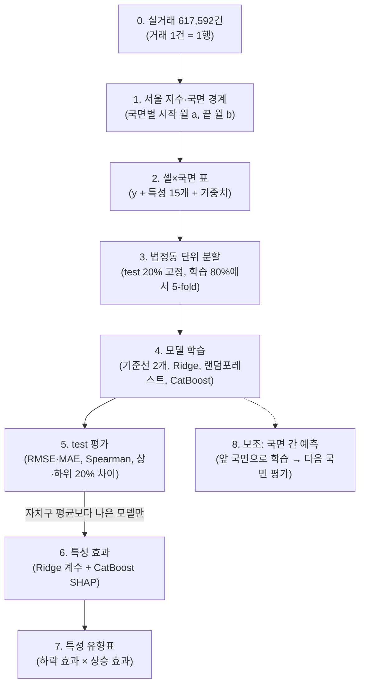

# 연구 방법

규칙의 값은 `config/*.yaml`에 고정되어 있다. 이 문서는 그 규칙이 무엇을 뜻하는지 예시 셀 하나로 따라가며 설명한다.

## 주제
**시장 국면별 서울 아파트 특성 효과 분석 — 하락기 방어·상승기 우위 특성의 구분**

서울 아파트 시장은 상승·조정·하락·회복 국면을 반복하지만, 같은 국면 안에서도 아파트마다 가격 움직임이 크게 다르다.
2017~2026년 서울 아파트 매매 실거래 617,592건으로 국면을 나눈다.
국면마다 각 아파트(단지×면적)가 서울 평균보다 얼마나 더(덜) 움직였는지를 특성으로 예측하는 회귀 모델을 만든다.
그 결과로 특성을 **전천후형·방어형·공격형·취약형·국면 무관**으로 구분한다.

- 예측 대상: 국면별 셀의 서울 대비 상대 가격 변동 y(%p). 회귀 문제다.
- 예측하지 않는 것: 시장 전체의 방향, 절대 가격
- 결과는 연관 관계이며 인과 효과로 해석하지 않는다.

---

## 분석 흐름 (입력 → 출력)

아래 설명은 예시 셀 하나(“A단지 84㎡”, 2021~23 하락기)를 따라간다. 예시 숫자는 이해를 돕기 위한 가상값이며, 서울 지수만 실제 값이다.

### 0단계. 원재료: 거래 한 건 = 한 행

| 계약일 | 단지 | 전용면적 | 층 | 거래금액 | 붙어 있는 정보 |
|---|---|---|---|---|---|
| 2021-09-12 | A단지 | 84.9㎡ | 12 | 12.3억 | 준공일, 세대수, 주차, 난방, 복도, 계약일 기준 최근접 역 거리·노선 수, 학교 거리·수, 자치구 |

### 1단계. 서울 지수와 국면: 기간을 자르는 기준

- 서울 지수: 같은 단지·같은 면적의 가격 변화로 월별 지수를 추정한다.
- 국면: 사전에 고정한 규칙(Bry–Boschan 단순화)을 한국부동산원 아파트 실거래가격지수에 적용해 정했다.

| 국면 | 기간 | 공식 실거래지수 변화 |
|---|---|---:|
| 상승기 ① | 2017-01 ~ 2018-10 | +34.7% |
| 조정기 | 2018-11 ~ 2019-04 | −5.1% |
| 상승기 ② | 2019-05 ~ 2021-10 | +64.1% |
| 하락기 | 2021-11 ~ 2023-01 | −23.6% |
| 회복기 | 2023-02 ~ 2024-07 | +14.7% |
| 상승기 ③ | 2024-08 ~ 진행 중 | +24.2% (~2026-08) |

출력: 국면별 시작 월 a와 끝 월 b(전환점). 하락기는 a = 2021-10, b = 2023-01이다.

### 2단계. 분석용 표 만들기: 거래 → 셀×국면 한 행

**① 셀 묶기.** 같은 단지·같은 면적(1㎡ 반올림)의 거래를 한 셀로 묶는다. A단지 84㎡가 하나의 셀이다.
셀은 10년 내내 같은 이름표를 쓰지만, 국면 하나를 분석할 때는 그 국면 기간의 거래만 쓴다. 그래서 같은 셀이 국면마다 한 행씩 등장한다.

**② y 계산.** 방법은 두 가지다.

*방법 1: 창 방식.*
- 시작 창은 a ±3개월(2021-07 ~ 2022-01), 끝 창은 b ±3개월(2022-10 ~ 2023-04)이다. 조정기는 국면이 6개월이라 ±2개월을 쓴다.
- 창 안의 거래를 서울 지수로 a월(또는 b월) 가격으로 환산한다. 예를 들어 2021-12 거래는 그 사이 서울이 움직인 만큼을 되돌려 2021-10 가격으로 바꾼다.
- 환산한 가격의 중앙값을 시작 가격, 끝 가격으로 쓴다.

| | 시작(2021-10 기준) | 끝(2023-01 기준) | 변화(로그, ×100) |
|---|---:|---:|---:|
| A단지 84㎡ | 12.0억 | 9.6억 | −22.3 |
| 서울 지수 | 211.5 | 161.5 | −26.9 |
| **y** | | | **+4.6%p (서울보다 덜 떨어짐)** |

*방법 2: 기울기 방식.* 국면 기간 안의 거래를 모두 쓴다.
1. 각 거래를 서울 대비 상대 가격으로 바꾼다: z = (ln 거래가 − ln 서울지수[거래 월]) × 100. 셀이 서울과 똑같이 움직이면 z는 수평선이다.
2. z를 경과 개월에 대해 직선 회귀해 기울기 s(%p/월)를 구한다.
3. y = s × 국면 길이(개월).

| 거래 월 | 경과 개월 | 서울 대비 상대 가격 |
|---|---:|---:|
| 2022-02 | 0 | 0 |
| 2022-06 | 4 | +1.0 |
| 2022-11 | 9 | +5.4 |

위 B단지 59㎡ 예시에서 기울기는 월 +0.61%p이고, y ≈ 0.61 × 15 = **+9.1%p**다. 이 셀은 시작 창에 거래가 없어 창 방식으로는 쓸 수 없다.

- 조건: 국면 안 거래 2건 이상, 첫 거래와 끝 거래 간격 6개월 이상.
- 가정: 셀의 상대적 강세(약세)가 국면 동안 대체로 일정하다.
- 창 방식은 기울기 방식의 특수한 경우다. 두 방식의 결론이 같은지 확인한다.

| 국면 | 창 방식 셀 | 기울기 방식 셀 |
|---|---:|---:|
| 상승기 ① | 5,950 | 10,538 |
| 조정기 | 4,630 | 4,456 |
| 상승기 ② | 4,460 | 11,820 |
| 하락기 | 2,883 | 4,359 |
| 회복기 | 3,483 | 6,556 |
| 상승기 ③ | 5,660 | 10,206 |
| 합계 | 27,066 | 47,935 |

**③ 입력 X.** 국면 시작 월 a 시점에 알 수 있던 값만 쓴다.

| 묶음 | 특성 |
|---|---|
| 규모 | 전용면적, 세대수 |
| 건물 | 연식(a월 기준 개월 수), 재건축 연한(30년) 도달, 층, 세대당 주차, 난방, 복도, 시공사 상위 10, 단지명 상위 10 브랜드 |
| 입지 | a월에 운영 중이던 역 기준 최근접 거리, 1km 내 노선 수, 최근접 초등학교 거리, 1km 내 학교 수(초·중·고 합) |
| 위치 | 자치구 |

결측은 채우지 않고 비워 둔다. 결측 여부 표시 변수를 함께 넣는다.

**④ 가중치.** 창 방식은 w = min(시작 창 거래 수, 끝 창 거래 수)이다. 기울기 방식은 거래 수와 간격에 비례해 준다.

출력: 국면별 표. 한 행은 (y, 특성 15개, 가중치)다.

특성 목록과 제외한 변수·이유는 `config/features.yaml`에 있다.

### 3단계. 데이터 나누기

- 서울의 법정동을 무작위로 나눠 **20%를 최종 test**로 고정한다. 모든 국면에서 같은 동을 쓴다.
- 나머지 **80%가 학습용**이며, 그 안에서 동 단위 5-fold 교차검증을 한다.
- 동 단위로 나누는 이유: 옆 단지 가격은 같이 움직인다. 같은 동네가 학습과 평가에 섞이면 점수가 부풀려진다.

### 4단계. 모델 학습

국면마다 따로 학습한다. 모든 모델이 같은 X, 같은 분할, 같은 가중치를 쓴다.

| 모델 | 하는 일 | ŷ를 내는 방식 |
|---|---|---|
| 기준선 1 | 아무 정보도 안 씀 | ŷ = 0 (서울과 똑같이 움직였다고 봄) |
| 기준선 2 | 위치만 씀 | ŷ = 학습 데이터의 자치구 평균 y |
| Ridge 회귀 | 특성마다 가중치를 곱해 더함. 숫자는 표준화, 범주는 0/1 변환 | ŷ = β₀ + β₁·연식 + β₂·세대수 + … |
| 랜덤포레스트 | 나무 수백 개가 데이터를 쪼개 각자 예측하고 평균 | 나무들의 평균 |
| CatBoost | 나무를 순서대로 쌓으며 앞 나무의 오차를 고침. 범주·결측을 그대로 처리 | 나무들의 합 |

하이퍼파라미터는 80% 안의 5-fold 교차검증으로 고른다. 고른 값으로 80% 전체에 다시 학습한다.

출력: test 셀마다 예측값 ŷ (예: A단지 84㎡ ŷ = +3.1%p, 실제 y = +4.6%p).

### 5단계. 평가 (test 20%에서 한 번만)

| 지표 | 계산 | 의미 |
|---|---|---|
| RMSE·MAE | ŷ와 y 차이의 크기(%p) | 값을 얼마나 가깝게 맞히나 |
| Spearman | ŷ 순위와 y 순위의 상관 | 누가 덜 떨어지고 누가 더 떨어지는지 순서를 맞히나 |
| 상·하위 20% 차이 | ŷ 상위 20% 셀의 실제 y 평균 − 하위 20% 셀의 실제 y 평균 | 모델이 “버틸 것”으로 고른 쪽이 실제로 몇 %p 덜 떨어졌나 |

**규칙: 기준선 2(자치구 평균)보다 나은 모델만 다음 단계에서 해석한다.**
못 이기면 "이 국면에서는 특성이 위치 이상의 설명을 못 한다"가 그 국면의 결론이다.

출력: 국면×모델 성능표.

### 6단계. 특성 효과 뽑기 (국면마다)

- **Ridge 계수:** 표준화 계수 β는 "그 특성이 1표준편차 높을 때 y가 β%p 변한다"는 뜻이다. 단지를 복원 추출해 1,000번 다시 학습해서 95% 구간을 구한다.
- **CatBoost SHAP:** 셀 하나의 예측을 특성별 기여로 나눈다. ŷ(A단지) = 평균 ŷ + φ(연식) + φ(세대수) + φ(역 거리) + …
  특성 x와 φ를 모든 셀에 대해 찍으면 "역 거리가 몇 m를 넘으면 불리해지는가" 같은 곡선이 나온다.
- **판정:** 두 방법의 부호가 같고 구간이 0을 포함하지 않을 때만 "효과 있음"(+ 또는 −)으로 본다. 아니면 0으로 둔다.
- **위치 vs 건물:** 기준선 2와 전체 모델의 test 성능 차이로, 위치가 설명하는 몫과 건물 특성이 더하는 몫을 나눈다.

출력: 국면별 특성 효과표(부호, 크기, 구간)와 SHAP 곡선.

### 7단계. 국면을 모아 특성 유형 판정 (사전 고정 규칙)

- 하락 효과: 하락기와 조정기에서의 판정
- 상승 효과: 상승기 ①②③에서의 판정. 3개 중 2개 이상 부호가 같아야 인정한다.

| 유형 | 하락 효과 | 상승 효과 |
|---|---|---|
| 전천후형 | + (덜 떨어짐) | + (더 오름) |
| 방어형 | + | 0 또는 − |
| 공격형 | − | + |
| 취약형 | − | − |
| 국면 무관 | 0 | 0 |

출력: **특성 유형표.** "어떤 특징을 가진 아파트가 국면별로 어떻게 움직이나"에 대한 최종 답이다.

### 8단계. 보조: 국면 간 예측 (사례로만 보고)

앞 국면에서 학습한 모델로 같은 유형의 다음 국면 셀의 y를 맞힌다. 조합은 상승① → 상승②, 상승② → 상승③, 조정 → 하락이다. 유형표가 시간이 지나도 유지되는지 확인하는 용도다. 하락 쪽 사례가 하나뿐이라 일반화 근거로 쓰지 않는다.

### 한 줄 요약

거래 61.8만 건 → 국면 경계 → 셀×국면 표(y + 특성 15개) → 동 단위 분할 → 기준선·Ridge·RF·CatBoost 학습 → test 성능 비교 → 이긴 모델의 계수·SHAP → 국면별 효과 → 특성 유형표

---

## 예비 결과 (파일럿, 창 방식)

같은 동 안의 특성 효과는 1차 추정치이며, 신뢰구간은 아직 없다.

| 국면 | 셀 수 | 처음 보는 동네 R²: 자치구만 → 자치구+특성 |
|---|---:|---|
| 하락기 | 2,875 | 0.13 → 0.15 |
| 상승기 ② | 4,435 | 0.21 → 0.35 |
| 회복기 | 3,481 | 0.16 → 0.25 |

- 하락기 차이는 주로 위치(동네)로 설명된다. 상승기 차이는 위치와 건물 특성이 함께 설명한다.
- 같은 동 안에서 연식과 세대수는 상승기에 +, 하락기에 −다. 공격형 후보다.

## 데이터와 한계

출처·변수·결측은 [데이터 규격](data.md), 판단 이유는 [결정 기록](decisions.md), 한계는 [README](../README.md#️-해석의-한계)에 정리했다.
