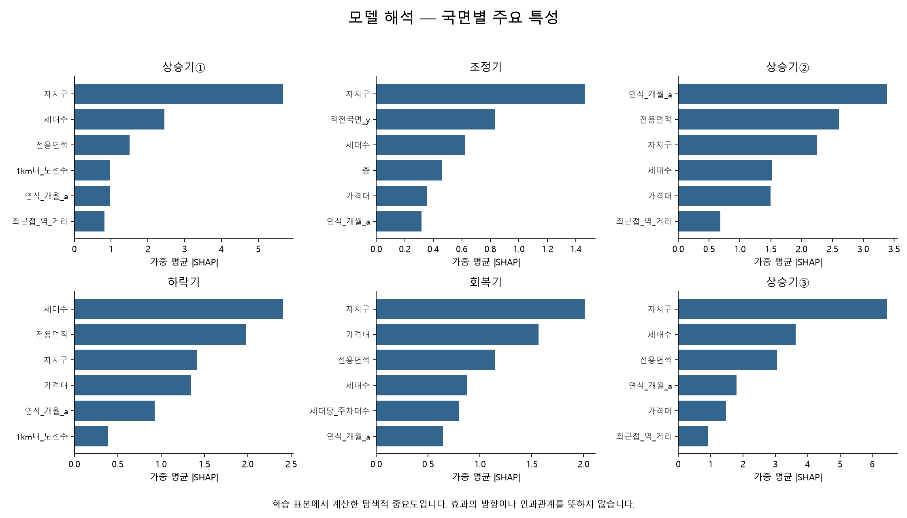

# 모델 해석 — 국면별 주요 특성과 SHAP

EDA 후속 비교에서 모델별로 선택한 사양을 학습 동네 전체에 적합하고 해석했다. 기존 v1 시험은 다시 열지 않았다. **아래는 탐색 결과이며 최종 인과효과나 확정 유형이 아니다.**

목표값은 서울 전체 대비 상대 로그가격 변화다. 아래 유형은 아파트를 분류한 결과가 아니라, 수치 특성이 커질 때의 상대 변화 방향을 묶은 후보다. 하락기의 +는 서울 대비 덜 하락하는 방향을 뜻하며 절대가격 상승을 뜻하지 않는다.

## 해석 방법

- Ridge: 학습 단지 단위 1,000회 부트스트랩. 선택된 사양·규제강도·기준 전처리를 고정한 조건부 구간이다. 모델/특성 선택의 불확실성은 포함하지 않는다.
- CatBoost: 표마다 학습 셀 최대 1,000개를 고정 시드로 추출해 내장 SHAP를 계산했다. SHAP 합과 예측값의 일치도 확인했다.
- 중요도는 가중 평균 |SHAP|다. 평균 SHAP 자체의 부호로 방향을 정하지 않는다.
- 수치 특성 방향은 특성값과 SHAP의 Spearman 부호로 요약한다. Ridge 구간이 0을 제외하고 방향도 같을 때만 +/− 후보로 표시한다. 전반적 방향은 비선형 관계를 숨길 수 있어 의존도 표도 함께 봐야 한다.
- 범주형은 중요도만 제시한다. 결측 표시와 자치구를 방어형·공격형 특성으로 판정하지 않는다. 제외된 특성은 NA이며, 0은 효과 없음의 증명이 아니라 일치한 증거 부족이다.
- Ridge와 CatBoost가 서로 다른 사양을 선택할 수 있어 부호 비교도 사양에 조건부다. 규모·거리 로그 변환 사양의 Ridge 계수는 변환된 값의 1표준편차 기준이다.

## 창 방식에서 중요한 특성

| 국면 | 평균 절대 SHAP 상위 5개 |
|---|---|
| 조정기 | 자치구 (1.46), 직전국면_y (0.83), 세대수 (0.62), 층 (0.46), 가격대 (0.36) |
| 하락기 | 세대수 (2.41), 전용면적 (1.98), 자치구 (1.42), 가격대 (1.34), 연식_개월_a (0.93) |
| 회복기 | 자치구 (2.01), 가격대 (1.56), 전용면적 (1.15), 세대수 (0.87), 세대당_주차대수 (0.80) |
| 상승기① | 자치구 (5.67), 세대수 (2.44), 전용면적 (1.50), 1km내_노선수 (0.97), 연식_개월_a (0.97) |
| 상승기② | 연식_개월_a (3.38), 전용면적 (2.61), 자치구 (2.25), 세대수 (1.52), 가격대 (1.50) |
| 상승기③ | 자치구 (6.45), 세대수 (3.63), 전용면적 (3.05), 연식_개월_a (1.80), 가격대 (1.47) |

## 특성 유형 후보

상승기 3개 중 2개 이상 방향이 같을 때 상승 방향으로 묶었다. 하락기만 적용한 경우와 하락기·조정기 방향이 모두 같은 경우를 나누어 저장했다. 회복기는 방향표에는 있으나 유형 판정에는 쓰지 않는다.

| 특성 | 창 방식 후보 | 기울기 방식 후보 |
|---|---|---|
| 1km내_노선수 | 전천후형 후보 | 전천후형 후보 |
| 1km내_학교수 | 공격형 후보 | 효과 미확인 |
| 단지명_상위10브랜드 | 혼합 또는 판단 유보 | 혼합 또는 판단 유보 |
| 세대당_주차대수 | 효과 미확인 | 혼합 또는 판단 유보 |
| 세대수 | 공격형 후보 | 공격형 후보 |
| 시공사_상위10 | 효과 미확인 | 효과 미확인 |
| 연식_개월_a | 공격형 후보 | 공격형 후보 |
| 재건축연한 | 효과 미확인 | 효과 미확인 |
| 전용면적 | 방어형 후보 | 방어형 후보 |
| 최근접_역_거리 | 효과 미확인 | 혼합 또는 판단 유보 |
| 최근접_초등학교_거리 | 효과 미확인 | 효과 미확인 |
| 층 | 혼합 또는 판단 유보 | 방어형 후보 |

유형이 방식·조정기 포함 여부에 따라 달라지면 안정적인 유형으로 확정하지 않는다. 현재값 가정·변수 상관·거래 선택 편향도 남는다.

## 상세 자료

- [Ridge 계수 구간](ridge_intervals.csv)
- [SHAP 중요도와 전반적 방향](shap_importance.csv)
- [SHAP 분위구간별 의존도](shap_dependence.csv)
- [국면별 수치 특성 방향](numeric_effects.csv)
- [조정기 포함·제외 유형 후보](type_candidates.csv)
- [해석 프로토콜과 한계](interpretation_protocol.json)
