# 서울 아파트 실거래 EDA 보고서

기계학습기초 4조 · 탐색적 자료 분석(EDA) · 대상: `data/final/아파트_실거래_전처리_2017_2026_v5.csv.xz`

> 이 문서의 숫자는 모두 `python src/eda/run_eda.py`가 실제 파일에서 계산해 `reports/eda/summary.json`과 `reports/eda/tables/*.csv`에 저장한 값이다. 이 문서는 그 파일을 읽어 `src/eda/report.py`가 만든다.
>
> **범위.** 기술 통계만 다룬다. 국면 정의(`config/regime.yaml`), 목표 변수 y(`config/target.yaml`), 특성 목록(`config/features.yaml`), 모델 학습은 건드리지 않았다. 셀×국면 표와 y는 만들지 않았다(모델링 담당 범위).

## 0. 요약

1. **파일은 문서와 일치한다.** 617,592건 × 43열, 계약일 2017-01-01 ~ 2026-10-30, 25개 자치구, 338개 법정동, 9,011개 단지. 완전 중복 0건, 거래ID 중복 0건.
2. **국면 표본이 크게 기운다.** 상승기 3개가 거래의 84.5%, 하락기+조정기는 4.5%(27,823건)다. 가장 많은 국면과 가장 적은 국면의 차이는 15.73배, 월평균으로도 7.83배다.
3. **하락기에 거래된 집은 평소와 구성이 다르다.** 전용 60㎡ 이하 53.3%(전체 41.0%), 300세대 미만 45.2%(전체 28.2%), 신축(5년 이하) 18.3%(전체 10.6%). 전체 단지의 45.9%만 하락기에 거래됐다.
4. **난방·복도·시공사 결측은 무작위가 아니다.** 거래 기준 약 35%지만 단지 기준으로는 76.8%이고, 하락기 48.3% · 조정기 45.2%로 하락 쪽 국면에서 더 높다(회복기 31.5%).
5. **문서에 없거나 문서와 다른 점.** 세대당 주차대수가 0으로 적힌 거래 4,550건(13개 단지), 날짜 형식이 아닌 사용승인일 17건, 문서와 다른 건수 2개(§1.5).

## 1. 자료 품질

### 1.1 크기와 기간

| 계약 연도 | 거래 건수 | 비율(%) |
|---|---:|---:|
| 2017 | 104,928 | 16.99 |
| 2018 | 81,579 | 13.21 |
| 2019 | 74,998 | 12.14 |
| 2020 | 80,858 | 13.09 |
| 2021 | 41,951 | 6.79 |
| 2022 | 12,047 | 1.95 |
| 2023 | 34,034 | 5.51 |
| 2024 | 55,184 | 8.94 |
| 2025 | 77,361 | 12.53 |
| 2026 | 54,652 | 8.85 |

- 계약 월은 118개(2017-01 ~ 2026-10)이고 모든 거래에 국면이 배정된다(미배정 0건).
- 2022년은 12,047건으로 전체의 1.95%뿐이다.
- 마지막 세 달은 2026-08 3,604건, 2026-09 3,424건, 2026-10 2,087건이다. 신고 기한 때문에 아직 덜 집계됐을 수도 있고 실제로 거래가 줄었을 수도 있다. 이 자료만으로는 구분할 수 없으므로 최근 월의 건수를 시장 신호로 읽지 않는다.

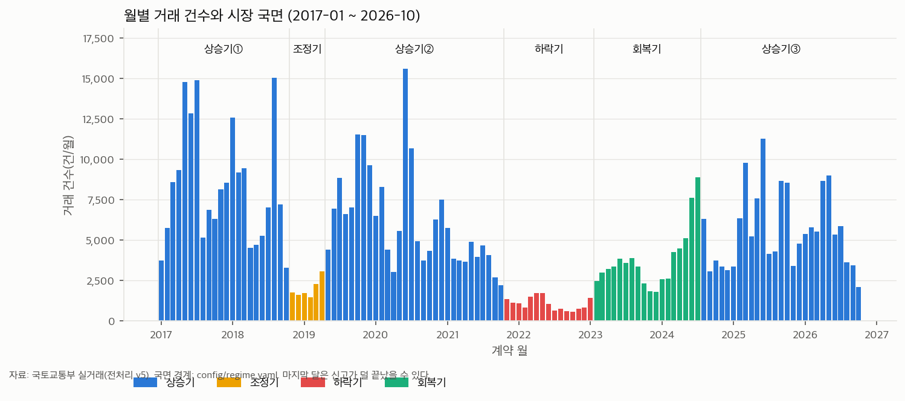

### 1.2 결측

43열 중 24개 열에 빈 값이 있다(`결측사유` 열 자체 포함).

| 열 | 결측건수 | 결측률(%) |
|---|---:|---:|
| 동 | 424,259 | 68.70 |
| 시공사 | 218,026 | 35.30 |
| 시공사_상위10 | 218,026 | 35.30 |
| 난방방식 | 217,716 | 35.25 |
| 복도유형 | 217,490 | 35.22 |
| 단지정보_현재값가정 | 217,483 | 35.21 |
| 결측사유 | 127,103 | 20.58 |
| 세대당_주차대수 | 75,555 | 12.23 |
| 사용승인일 | 59,884 | 9.70 |
| 세대수 | 6,795 | 1.10 |
| 세대수_기준 | 6,795 | 1.10 |
| 1km내_노선수 | 358 | 0.06 |
| 1km내_학교수 | 358 | 0.06 |
| 경도 | 358 | 0.06 |
| 위도 | 358 | 0.06 |
| 좌표기준 | 358 | 0.06 |
| 최근접_역_거리(m) | 358 | 0.06 |
| 최근접_역_호선 | 358 | 0.06 |
| 최근접_역명 | 358 | 0.06 |
| 최근접_초등학교_거리(m) | 358 | 0.06 |
| 연식_개월 | 253 | 0.04 |
| 도로명 | 245 | 0.04 |
| 건물연식 | 39 | 0.01 |
| 건물연식_구분 | 39 | 0.01 |

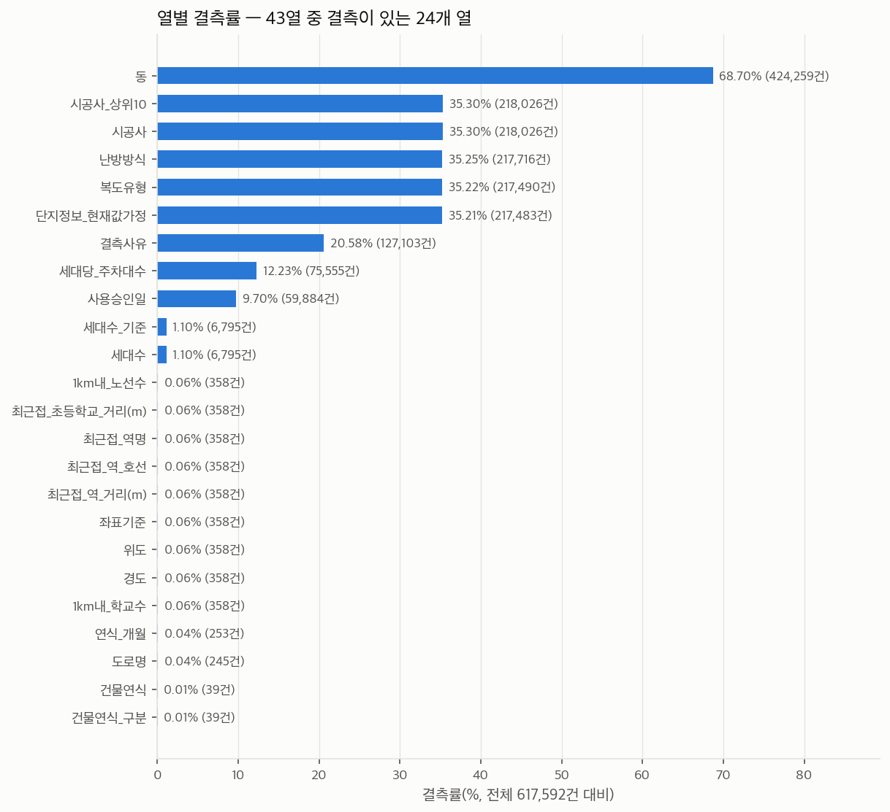

**결측사유.** `결측사유`를 항목별로 나누면 다음과 같다(한 거래에 사유가 여러 개일 수 있다).

| 항목 | 이유 | 건수 | 비율(%) |
|---|---|---:|---:|
| 동 | 원자료에 동 미공개 | 424,259 | 68.70 |
| 난방·복도·시공사 | 단지 목록에 없어 미기재(건축물대장에는 항목 없음) | 214,475 | 34.73 |
| 사용승인일 | 건축물대장에 사용승인일 미기재(연식은 건축년도 기준) | 53,954 | 8.74 |
| 주차 | 건축물대장에 주차대수 미기재 | 38,961 | 6.31 |
| 주차 | 원자료에 값이 없거나 0으로 기재 | 29,177 | 4.72 |
| 건축물대장 | 채우지 못함: 응답 없음 | 5,033 | 0.81 |
| 단지정보 | 단지정보 없음(단지 목록에서 이 단지를 찾지 못함) | 4,729 | 0.77 |
| 단지정보 | 단지정보 불확실(같은 단지인지 확정하지 못함) | 1,641 | 0.27 |
| 건축물대장 | 채우지 못함: 사용승인연도 불일치 | 919 | 0.15 |
| 주차 | 기간 중 변경 이력이 의심되어 제외 | 738 | 0.12 |
| 건축물대장 | 채우지 못함: 세대수 기재 없음(공동주택 아님 등) | 738 | 0.12 |
| 연식_개월 | 사용승인일 이전 계약(분양권·입주권 등) | 370 | 0.06 |
| 입지 | 주소 소실 추정(재건축·번지 변경 등)으로 좌표를 찾지 못해 역·학교 거리 계산 불가 | 358 | 0.06 |
| 단지정보 | 건축년도와 단지 준공연도가 달라 단지값 미적용 | 267 | 0.04 |

- 사유가 하나도 없는 거래는 127,103건(20.6%)이다.
- 동·세대수·주차·난방·좌표가 빈 거래 가운데 해당 사유가 적히지 않은 경우는 0건이다(`tables/01_결측_사유없는건수.csv`). 빈 값은 모두 이유가 기록되어 있다.
- 결측은 세 덩어리로 묶인다: ① 동(2022년 이전 미공개), ② K-apt 단지 목록에 없는 단지의 난방·복도·시공사, ③ 건축물대장에 주차·사용승인일 미기재.

### 1.3 중복

- 43열이 모두 같은 행: 0건. 거래ID 중복: 0건.
- 단지·전용면적·층·계약일·거래금액이 모두 같은 거래 묶음: 2,491개(묶음에 속한 행 6,997건, 두 번째 이후 행 4,506건 = 전체의 0.73%). 가장 큰 묶음은 14건이다.
- 이 묶음의 66.0%가 전용 40㎡ 이하다(전체 거래에서는 7.9%). 동(棟)이 공개된 967개 묶음 중 856개는 동도 같고 111개는 동이 다르다.
- 같은 층의 여러 호실이 같은 날 같은 값에 팔린 실제 거래인지, 중복 신고·해제 후 재신고인지는 이 자료로 가릴 수 없다(호수 정보 없음, 2017~2019년은 해제 표시 없음). **지우지 않고 사실만 적는다.**

| 계약 연도 | 거래 건수 | 같은 조건 두 번째 이후 | 비율(%) |
|---|---:|---:|---:|
| 2017 | 104,928 | 269 | 0.26 |
| 2018 | 81,579 | 287 | 0.35 |
| 2019 | 74,998 | 393 | 0.52 |
| 2020 | 80,858 | 397 | 0.49 |
| 2021 | 41,951 | 314 | 0.75 |
| 2022 | 12,047 | 480 | 3.98 |
| 2023 | 34,034 | 475 | 1.40 |
| 2024 | 55,184 | 397 | 0.72 |
| 2025 | 77,361 | 712 | 0.92 |
| 2026 | 54,652 | 782 | 1.43 |

2022년의 비율(3.98%)이 다른 해보다 높다. 원인은 확인하지 못했다.

### 1.4 값 점검

열 사이의 계산 관계(계약년월·평수·평당가·건물연식), 범주 허용값, 좌표 범위는 위반이 없다. 0이 아닌 항목만 적는다.

| 점검 | 위반건수 | 비고 |
|---|---:|---|
| 층 ≤ 0 | 120 | 지하·반지하 표기일 수 있음(오류로 단정하지 않음) |
| 건축년도 > 계약연도 | 39 | 준공 전 거래(분양권·입주권) 가능 |
| 연식_기준 = '준공 전 거래' | 253 | config/target.yaml의 제외 대상 |
| 사용승인일이 날짜 형식(YYYY-MM-DD)이 아님 | 17 | 일(日)이 '00'으로 적힌 값 |
| 사용승인일이 계약일보다 뒤 | 346 | '준공 전 거래' + 같은 달 안에서 승인일이 며칠 늦은 거래 |
| 좌표 없음 | 358 | 결측사유 '주소 소실 추정'. 모델 표본 제외 대상 |
| 세대당_주차대수 = 0 | 4,550 | 값은 있으나 0. 결측사유에 주차 항목 없음 → 사실상 미기재로 보임 |
| 세대당_주차대수 > 3 | 3,869 | 주상복합 등 비주거 주차 포함 추정(docs/data.md §6) |
| 세대수_기준 = '건축물대장(번지 합계)' | 17,592 | 번지 전체 세대수 |

- **세대당 주차대수 = 0 (4,550건, 13개 단지).** 결측사유에 주차 항목이 없어 "값 있음"으로 집계되지만, 트리지움(3,696세대, 1,124건)처럼 대단지가 포함되어 있어 실제 0대가 아니라 미기재로 보인다. 목록은 `tables/01_주차0_단지.csv`.
- **사용승인일 형식 오류 17건.** 일(日)이 `00`인 값이다(예: `1970-03-00`). 날짜로 읽으면 오류가 나거나 결측이 된다.
- **층 ≤ 0: 120건.** 지하·반지하 표기일 수 있어 오류로 단정하지 않는다.
- **세대당 주차대수 > 3: 3,869건.** 주상복합의 비주거 주차가 섞인 것으로 문서에 적혀 있다.

### 1.5 문서와 다른 숫자

| 항목 | 문서의 값 | 실제 파일 | 비고 |
|---|---:|---:|---|
| `연식_기준 = '준공 전 거래'` | 125 (`docs/handoff.md` §4-3) | 253 | `docs/data.md` §5는 253건으로 적혀 있어 실제와 같다. handoff의 125가 옛 값으로 보인다 |
| 세대당 주차대수 > 3 | 3,350 (`docs/data.md` §6, `docs/handoff.md` §5-1) | 3,869 | 건축물대장 보완(v5) 이후 늘어난 것으로 추정 |
| 세대당 주차대수 = 0 | 언급 없음 | 4,550 | 결측으로 처리되지 않음 |
| 사용승인일 형식 오류 | 언급 없음 | 17 | |

행·열 수, 열별 결측 건수(동, 좌표 358건, 세대수 6,795건, 주차 75,555건 등)는 `docs/data.md`와 일치한다. 문서는 고치지 않았다(담당자 확인 필요).

### 1.6 이상치

분포의 꼬리를 보는 용도다. 지울 대상이 아니다.

| 열 | 건수 | 최솟값 | p1 | p25 | 중앙값 | p75 | p99 | 최댓값 |
|---|---:|---:|---:|---:|---:|---:|---:|---:|
| 거래금액_만원 | 617,592 | 4,732 | 12,500 | 47,000 | 72,000 | 113,500 | 374,000 | 2,900,000 |
| ㎡당가_만원 | 617,592 | 121.34 | 363.99 | 703.67 | 999.10 | 1,453.41 | 3,928.53 | 10,586.70 |
| 전용면적(㎡) | 617,592 | 10.02 | 14.46 | 59.68 | 82.32 | 84.96 | 173.17 | 395.06 |
| 층 | 617,592 | -3 | 1 | 4 | 8 | 13 | 28 | 69 |
| 건물연식 | 617,553 | 0 | 0 | 12 | 19 | 27 | 45 | 65 |
| 연식_개월 | 617,339 | 0 | 3 | 141 | 231 | 321 | 541 | 775 |
| 세대수 | 610,797 | 2 | 14 | 268 | 660 | 1,372 | 5,563 | 12,032 |
| 세대당_주차대수 | 542,037 | 0 | 0.01 | 0.81 | 1.10 | 1.26 | 2.85 | 12.46 |
| 최근접_역_거리(m) | 617,234 | 18 | 90 | 323 | 478 | 691 | 1,867 | 3,595 |
| 1km내_노선수 | 617,234 | 0 | 0 | 1 | 2 | 2 | 4 | 7 |
| 최근접_초등학교_거리(m) | 617,234 | 24 | 76 | 205 | 303 | 423 | 776 | 1,776 |
| 1km내_학교수 | 617,234 | 0 | 2 | 7 | 10 | 13 | 21 | 22 |

- 가격·면적·세대수는 오른쪽 꼬리가 길다(거래금액 왜도 3.91). 평균 대신 중앙값·분위수로 요약했다.
- 시기·위치를 걷어낸 가격 이상치: 같은 자치구·같은 계약 월 안에서 ln(㎡당가)의 robust z가 3을 넘는 거래는 7,252건(1.18%)이고, 낮은 쪽 4,995건 · 높은 쪽 2,257건이다. 낮은 쪽이 더 많다. 직거래(가족 간 거래 등) 가능성이 있으나 v5에는 거래유형 열이 없어 확인하지 못했다.

## 2. 가격

> 가격은 y의 재료라 모델 특성이 아니다(`config/features.yaml` excluded). 이 절은 자료가 어떻게 생겼는지 보여 주는 기술 통계다.

### 2.1 분포

| 변수 | 건수 | 평균 | p5 | p25 | 중앙값 | p75 | p95 | 최솟값 | 최댓값 |
|---|---:|---:|---:|---:|---:|---:|---:|---:|---:|
| 거래금액_억원 | 617,592 | 9.19 | 2.49 | 4.70 | 7.20 | 11.35 | 22.50 | 0.47 | 290 |
| ㎡당가_만원 | 617,592 | 1,191.19 | 464.48 | 703.67 | 999.10 | 1,453.41 | 2,588.51 | 121.34 | 10,586.70 |
| 평당가_만원 | 617,592 | 3,937.80 | 1,535 | 2,326 | 3,303 | 4,805 | 8,557 | 401 | 34,997 |
| 전용면적(㎡) | 617,592 | 76.76 | 34.44 | 59.68 | 82.32 | 84.96 | 131.44 | 10.02 | 395.06 |

- 거래금액 중앙값 7.2억 원, 전용 ㎡당 가격 중앙값 999만 원/㎡(평당 3,303만 원). 10년치 명목 가격을 합친 값이라 시기별 수준 차이가 섞여 있다.
- 가격대: 3억 이하 8.7%, 3~6억 31.0%, 6~9억 25.0%, 9~15억 21.7%, 15~30억 11.5%, 30억 초과 2.1%.

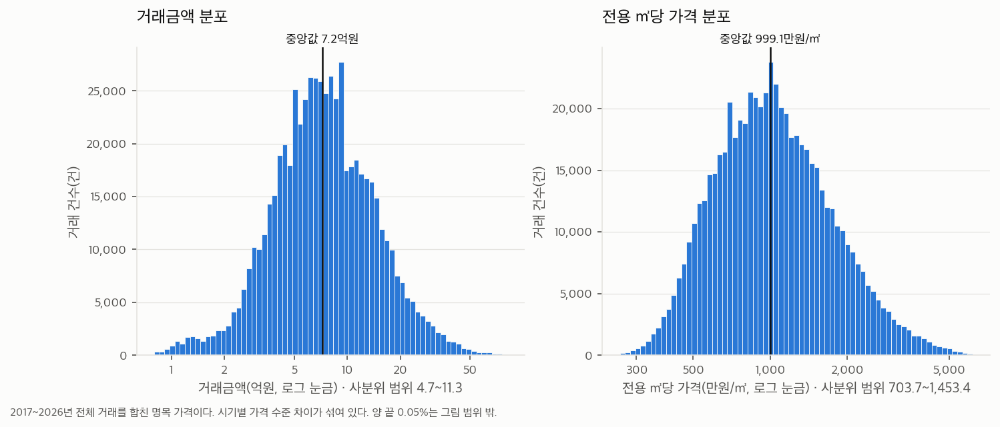

### 2.2 자치구

| 자치구 | 권역 | 거래 건수 | ㎡당가 p25 | ㎡당가 중앙값(만원) | ㎡당가 p75 | 거래금액 중앙값(억) | 전용면적 중앙값(㎡) |
|---|---|---:|---:|---:|---:|---:|---:|
| 강남구 | 동남권 | 33,651 | 1,461.8 | 2,072.3 | 2,820.4 | 17 | 84.7 |
| 서초구 | 동남권 | 26,508 | 1,170.8 | 1,742.2 | 2,602.5 | 16.5 | 84.9 |
| 송파구 | 동남권 | 41,140 | 1,059.5 | 1,516.1 | 2,139.8 | 12.1 | 84.8 |
| 용산구 | 도심권 | 12,081 | 1,073.9 | 1,504.0 | 2,050.8 | 13.5 | 84.9 |
| 성동구 | 동북권 | 24,932 | 988.4 | 1,383.2 | 1,867.3 | 10.4 | 84.5 |
| 마포구 | 서북권 | 24,182 | 941.3 | 1,295.6 | 1,765.3 | 9.7 | 84.5 |
| 광진구 | 동북권 | 12,598 | 884.7 | 1,216.9 | 1,648.6 | 9.5 | 84.6 |
| 동작구 | 서남권 | 23,738 | 865.6 | 1,164.4 | 1,566.1 | 9 | 84.8 |
| 영등포구 | 서남권 | 28,016 | 818.7 | 1,124.0 | 1,499.6 | 8.2 | 79.8 |
| 중구 | 도심권 | 8,571 | 835.9 | 1,102.0 | 1,468.0 | 8.5 | 84.0 |
| 강동구 | 동남권 | 33,586 | 780.0 | 1,084.1 | 1,570.2 | 8.1 | 83.2 |
| 양천구 | 서남권 | 27,602 | 680.7 | 1,053.2 | 1,512.9 | 7.9 | 83.7 |
| 서대문구 | 서북권 | 21,453 | 717.4 | 1,004.4 | 1,362.4 | 7.3 | 84.3 |
| 종로구 | 도심권 | 5,352 | 718.2 | 942.0 | 1,334.5 | 7.5 | 84.0 |
| 동대문구 | 동북권 | 24,812 | 679.3 | 920.0 | 1,227.7 | 6.5 | 81.0 |
| 강서구 | 서남권 | 36,480 | 694.7 | 918.0 | 1,223.7 | 6.3 | 70.5 |
| 성북구 | 동북권 | 32,724 | 633.9 | 852.1 | 1,126.3 | 6.5 | 84.1 |
| 은평구 | 서북권 | 23,162 | 616.0 | 832.1 | 1,143.7 | 6 | 83.0 |
| 관악구 | 서남권 | 19,501 | 622.7 | 824.8 | 1,061.6 | 5.9 | 76.9 |
| 노원구 | 동북권 | 57,819 | 588.8 | 771.0 | 1,000.1 | 4.7 | 59.4 |
| 구로구 | 서남권 | 31,605 | 555.4 | 745.0 | 989.6 | 5.2 | 66.6 |
| 중랑구 | 동북권 | 20,105 | 557.0 | 722.8 | 941.3 | 4.7 | 68.1 |
| 강북구 | 동북권 | 12,645 | 544.7 | 716.7 | 924.3 | 5.1 | 82.0 |
| 금천구 | 서남권 | 10,820 | 500.5 | 660.0 | 886.4 | 4.4 | 67.3 |
| 도봉구 | 동북권 | 24,509 | 475.9 | 620.2 | 800.7 | 4.1 | 68.9 |

- ㎡당 가격 중앙값은 강남구 2,072만 원에서 도봉구 620만 원까지 3.3배 차이다.
- 거래가 가장 많은 구는 노원구(57,819건), 가장 적은 구는 종로구(5,352건)다.
- 구 안의 차이도 크다. 사분위 범위가 강남구 1,462~2,820만 원, 도봉구 476~801만 원으로 비싼 구일수록 넓다.

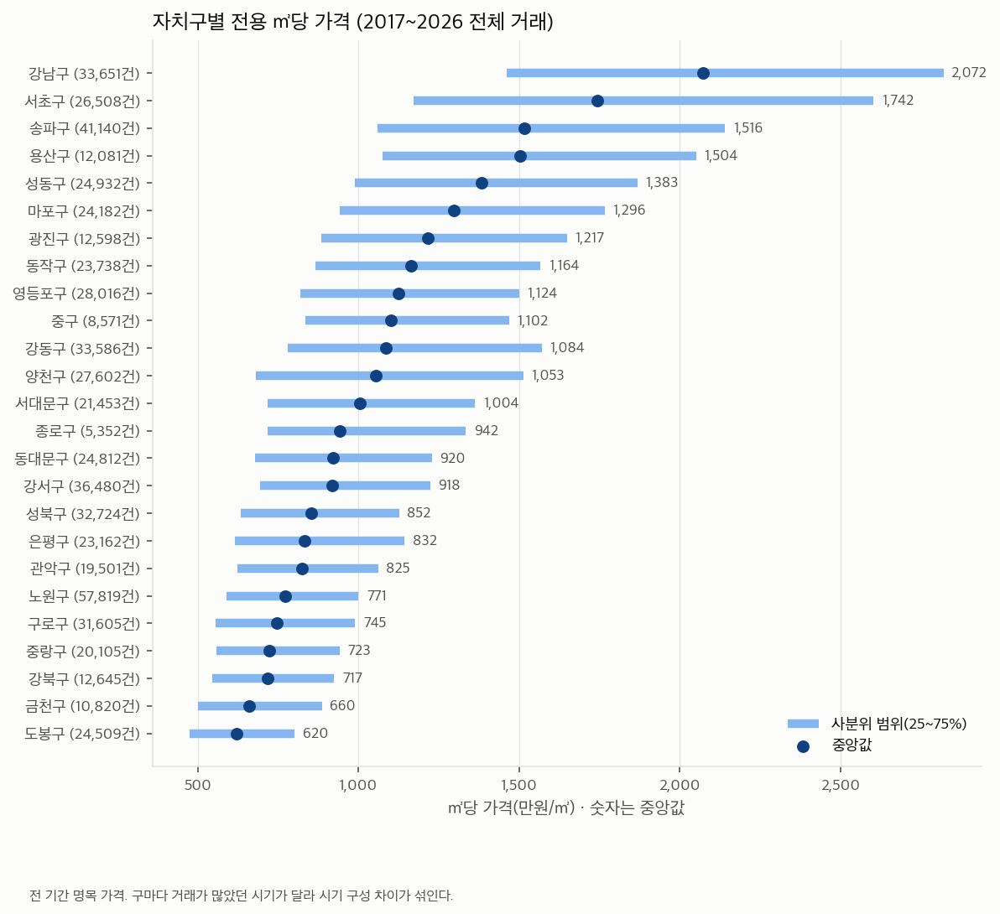

### 2.3 면적·층·연식

시기와 위치를 걷어내기 위해 "같은 계약 연도·같은 자치구의 ㎡당가 중앙값 대비 %"(상대 가격)를 함께 냈다.

| 면적구간 | 거래 건수 | ㎡당가 중앙값(만원) | 거래금액 중앙값(억) | 상대 가격 중앙값(%) |
|---|---:|---:|---:|---:|
| 40㎡ 이하 | 49,031 | 987.5 | 2.7 | 2.6 |
| 40~60㎡ | 203,919 | 1,059.8 | 6.0 | 9.1 |
| 60~85㎡ | 257,123 | 954.4 | 7.8 | -3.3 |
| 85~102㎡ | 16,370 | 1,088.6 | 10.5 | 0.9 |
| 102~135㎡ | 66,736 | 895.8 | 10.5 | -14.5 |
| 135㎡ 초과 | 24,413 | 1,165.0 | 18.7 | -13.6 |

| 층구간 | 거래 건수 | ㎡당가 중앙값(만원) | 거래금액 중앙값(억) | 상대 가격 중앙값(%) |
|---|---:|---:|---:|---:|
| 0층 이하 | 120 | 756.8 | 7.0 | -29.9 |
| 1~2층 | 72,140 | 889.5 | 6.5 | -8.0 |
| 3~5층 | 126,936 | 939.0 | 6.7 | -4.5 |
| 6~10층 | 186,161 | 988.4 | 7.0 | -0.4 |
| 11~15층 | 142,417 | 1,017.5 | 7.2 | 2.3 |
| 16~20층 | 57,404 | 1,094.3 | 8.4 | 6.2 |
| 21~30층 | 28,231 | 1,301.6 | 10.8 | 14.7 |
| 31층 이상 | 4,183 | 1,654.7 | 17.4 | 23.1 |

| 연식구간 | 거래 건수 | ㎡당가 중앙값(만원) | 거래금액 중앙값(억) | 상대 가격 중앙값(%) |
|---|---:|---:|---:|---:|
| 5년 이하 | 65,660 | 1,343.0 | 8.9 | 25.7 |
| 6~10년 | 68,894 | 1,119.1 | 8.7 | 13.2 |
| 11~15년 | 89,075 | 870.9 | 7.2 | -2.3 |
| 16~20년 | 114,177 | 854.7 | 6.6 | -7.0 |
| 21~25년 | 102,752 | 935.4 | 6.8 | -8.3 |
| 26~30년 | 77,260 | 910.4 | 6.2 | -4.8 |
| 31~35년 | 54,488 | 1,042.0 | 6.7 | 2.3 |
| 36~40년 | 29,826 | 1,359.3 | 9.8 | 9.0 |
| 40년 초과 | 15,421 | 1,738.6 | 16.8 | 10.6 |

- **면적.** ㎡당 가격은 40~60㎡에서 가장 높고(상대 가격 +9.1%), 102㎡를 넘으면 낮다(-14.5%). 총액은 면적과 함께 커진다.
- **층.** 층이 높을수록 상대 가격이 꾸준히 높다(1~2층 -8.0% → 21~30층 +14.7%). 층은 건물 높이(고층 건물 여부)와 겹치므로 층만의 효과로 읽지 않는다.
- **연식.** U자 모양이다. 5년 이하 +25.7%, 21~25년 -8.3%, 36~40년 +9.0%. 오래된 단지의 상대 가격이 다시 높아지는 이유(재건축 기대, 입지 등)는 이 표로 가릴 수 없다.

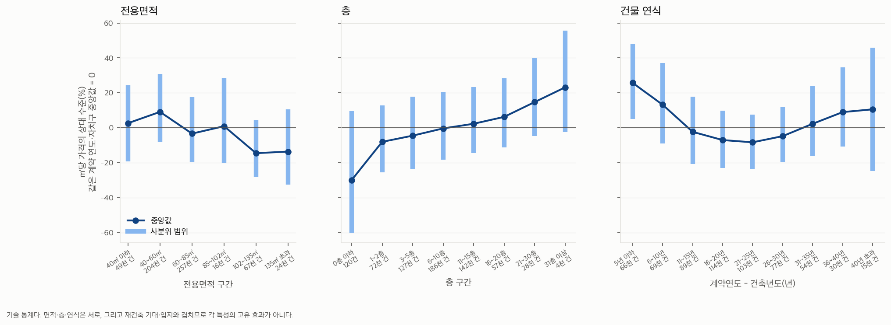

**순위상관(Spearman), ln(㎡당가) 기준.**

| 변수 | 건수 | 전체 | 연도·자치구 중앙값을 뺀 뒤 |
|---|---:|---:|---|
| 전용면적(㎡) | 617,592 | -0.003 | 0 |
| 층 | 617,592 | 0.139 | 0 |
| 건물연식 | 617,553 | -0.045 | 0 |
| 세대수 | 610,797 | 0.273 | 0 |
| 세대당_주차대수 | 542,037 | 0.183 | 0 |
| 최근접_역_거리(m) | 617,234 | -0.190 | 0 |
| 1km내_노선수 | 617,234 | 0.252 | 0 |
| 최근접_초등학교_거리(m) | 617,234 | -0.008 | 0 |
| 1km내_학교수 | 617,234 | -0.086 | 0 |

- 연도·자치구를 걷어내면 세대수의 상관이 0.48로 가장 크다. 연관의 크기일 뿐이며, 이 표로 특성을 고르거나 효과를 주장하지 않는다(특성 목록은 이미 고정).

## 3. 시장 국면

국면 경계는 `config/regime.yaml`의 확정값을 그대로 읽었다. 계약 월이 `start`~`end`에 드는 거래를 그 국면에 배정했고, 끝이 없는 상승기③은 자료 끝(2026-10)까지다.

### 3.1 거래 건수와 불균형

| 국면 | 첫 계약 월 | 끝 계약 월 | 개월 수 | 거래 건수 | 비율(%) | 월평균(건) | 최다 국면 대비 |
|---|---|---|---:|---:|---:|---:|---:|
| 상승기① | 2017-01 | 2018-10 | 22 | 183,144 | 29.65 | 8,325 | 0.98 |
| 조정기 | 2018-11 | 2019-04 | 6 | 11,875 | 1.92 | 1,979 | 0.06 |
| 상승기② | 2019-05 | 2021-10 | 30 | 186,805 | 30.25 | 6,227 | 1 |
| 하락기 | 2021-11 | 2023-01 | 15 | 15,948 | 2.58 | 1,063 | 0.09 |
| 회복기 | 2023-02 | 2024-07 | 18 | 68,190 | 11.04 | 3,788 | 0.36 |
| 상승기③ | 2024-08 | 2026-10 | 27 | 151,630 | 24.55 | 5,616 | 0.81 |

- 하락기는 15개월 동안 15,948건(2.58%), 조정기는 6개월 동안 11,875건(1.92%)이다. 상승기② 186,805건의 8.5%와 6.4% 수준이다.
- 기간 길이 차이를 걷어낸 월평균으로도 하락기(1,063건/월)는 상승기①(8,325건/월)의 13%다. 국면이 짧아서가 아니라 거래 자체가 줄어서 표본이 작다.
- 상승 쪽 521,579건 · 하락 쪽(하락기+조정기) 27,823건 · 회복기 68,190건. "하락기 방어" 쪽 결론은 상승 쪽보다 훨씬 적은 거래에 기대게 된다.

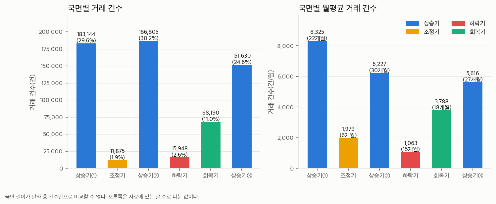

### 3.2 분포 비교

| 변수 | 국면 | 건수 | p25 | 중앙값 | p75 |
|---|---|---:|---:|---:|---:|
| ㎡당가_만원 | 상승기① | 183,144 | 535.7 | 681.2 | 919.9 |
| ㎡당가_만원 | 조정기 | 11,875 | 567.5 | 743.2 | 1,041.3 |
| ㎡당가_만원 | 상승기② | 186,805 | 750.5 | 1,003.2 | 1,383.6 |
| ㎡당가_만원 | 하락기 | 15,948 | 904.5 | 1,183.4 | 1,605.5 |
| ㎡당가_만원 | 회복기 | 68,190 | 957.9 | 1,277.7 | 1,765.4 |
| ㎡당가_만원 | 상승기③ | 151,630 | 1,000.4 | 1,358.0 | 1,941.6 |
| 전용면적(㎡) | 상승기① | 183,144 | 59.8 | 84.4 | 85.0 |
| 전용면적(㎡) | 조정기 | 11,875 | 56.8 | 74.0 | 85.0 |
| 전용면적(㎡) | 상승기② | 186,805 | 59.6 | 80.0 | 85.0 |
| 전용면적(㎡) | 하락기 | 15,948 | 41.3 | 60.0 | 84.9 |
| 전용면적(㎡) | 회복기 | 68,190 | 59.8 | 79.1 | 85.0 |
| 전용면적(㎡) | 상승기③ | 151,630 | 59.7 | 79.2 | 85.0 |
| 건물연식 | 상승기① | 183,141 | 11 | 17 | 24 |
| 건물연식 | 조정기 | 11,875 | 11 | 18 | 26 |
| 건물연식 | 상승기② | 186,770 | 12 | 19 | 26 |
| 건물연식 | 하락기 | 15,948 | 8 | 18 | 25 |
| 건물연식 | 회복기 | 68,190 | 10 | 20 | 27 |
| 건물연식 | 상승기③ | 151,629 | 14 | 23 | 30 |
| 세대수 | 상승기① | 179,694 | 267 | 642 | 1,372 |
| 세대수 | 조정기 | 11,587 | 145 | 470 | 1,170 |
| 세대수 | 상승기② | 184,937 | 242 | 619 | 1,352 |
| 세대수 | 하락기 | 15,684 | 127 | 408 | 1,165 |
| 세대수 | 회복기 | 67,847 | 349 | 805 | 1,584 |
| 세대수 | 상승기③ | 151,048 | 297 | 708 | 1,372 |

- 하락기 ㎡당가 중앙값(1,183만 원)이 직전 상승기②(1,003만 원)보다 **높다**. 가격이 올랐다는 뜻이 아니다. 상승기②는 30개월에 걸친 상승 구간 전체의 거래를 합친 값이고, 하락기에는 거래된 집의 구성도 바뀌었다(§3.3). **원시 중앙값은 가격지수가 아니다.** 국면 판정은 같은 집의 가격 변화를 보는 지수로 했다.
- 전용면적 중앙값은 하락기에만 60㎡로 내려간다(다른 국면 74~84㎡).

국면 쌍별 분포 거리(Kolmogorov–Smirnov 통계량, 0 = 같음). 표본이 커서 p값은 의미가 없어 내지 않았다.

㎡당 가격:

| 국면 | 상승기① | 조정기 | 상승기② | 하락기 | 회복기 | 상승기③ |
|---|---:|---:|---:|---:|---:|---:|
| 상승기① | 0 | 0.093 | 0.345 | 0.490 | 0.538 | 0.565 |
| 조정기 | 0.093 | 0 | 0.263 | 0.409 | 0.457 | 0.485 |
| 상승기② | 0.345 | 0.263 | 0 | 0.165 | 0.212 | 0.255 |
| 하락기 | 0.490 | 0.409 | 0.165 | 0 | 0.072 | 0.120 |
| 회복기 | 0.538 | 0.457 | 0.212 | 0.072 | 0 | 0.059 |
| 상승기③ | 0.565 | 0.485 | 0.255 | 0.120 | 0.059 | 0 |

전용면적:

| 국면 | 상승기① | 조정기 | 상승기② | 하락기 | 회복기 | 상승기③ |
|---|---:|---:|---:|---:|---:|---:|
| 상승기① | 0 | 0.096 | 0.059 | 0.190 | 0.079 | 0.071 |
| 조정기 | 0.096 | 0 | 0.065 | 0.125 | 0.092 | 0.077 |
| 상승기② | 0.059 | 0.065 | 0 | 0.166 | 0.028 | 0.019 |
| 하락기 | 0.190 | 0.125 | 0.166 | 0 | 0.185 | 0.171 |
| 회복기 | 0.079 | 0.092 | 0.028 | 0.185 | 0 | 0.015 |
| 상승기③ | 0.071 | 0.077 | 0.019 | 0.171 | 0.015 | 0 |

- ㎡당 가격의 거리는 시간 순서를 따른다(가격 수준 상승). 전용면적은 하락기만 다른 모든 국면과 떨어져 있다(거리 0.125~0.190, 그 밖의 쌍은 최대 0.096).

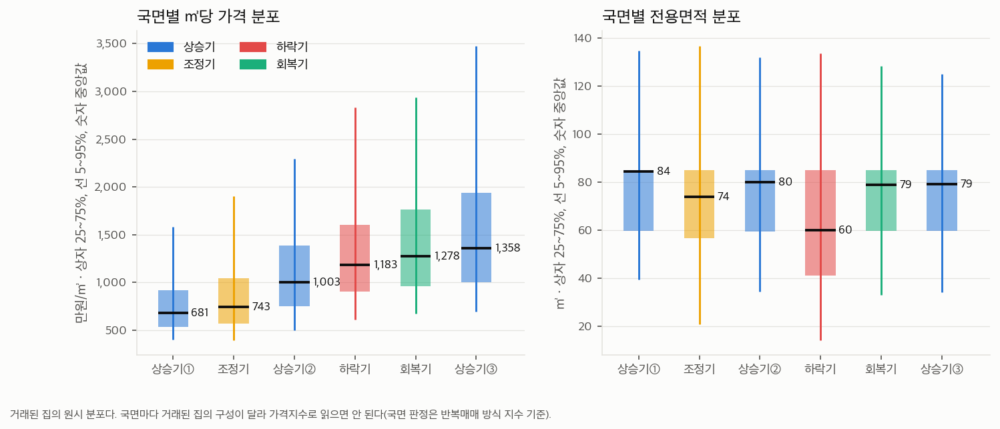

### 3.3 거래 구성과 선택 편향

| 국면 | 동남권(강남·서초·송파·강동)(%) | 전용 60㎡ 이하(%) | 신축(5년 이하)(%) | 30년 초과(%) | 1,000세대 이상(%) | 300세대 미만(%) | 상위10 브랜드 단지명(%) | 역 500m 이내(%) | 토지거래허가구역 거래(%) |
|---|---:|---:|---:|---:|---:|---:|---:|---:|---:|
| 상승기① | 22.4 | 36 | 9.8 | 9.9 | 33.7 | 28.2 | 18.3 | 51.5 | 0 |
| 조정기 | 20.6 | 43.3 | 12.0 | 16.3 | 27.8 | 40.5 | 13.3 | 53.2 | 0 |
| 상승기② | 20.7 | 41.8 | 10.2 | 15.3 | 33.2 | 30.1 | 18.7 | 52.6 | 0.7 |
| 하락기 | 22.7 | 53.3 | 18.3 | 14.7 | 27.9 | 45.2 | 17.4 | 57.9 | 4.7 |
| 회복기 | 25.3 | 43.9 | 14.5 | 18.3 | 40.3 | 22.8 | 28.3 | 56.9 | 4.9 |
| 상승기③ | 21.0 | 43.1 | 9.6 | 23.9 | 35.5 | 25.7 | 24.4 | 55.5 | 47.4 |
| 전체 | 21.8 | 41.0 | 10.6 | 16.1 | 34.5 | 28.2 | 20.9 | 53.6 | 12.5 |

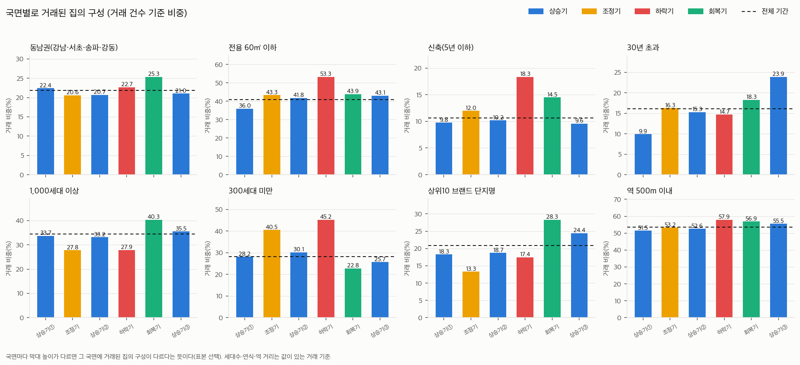

- **하락기·조정기에는 작은 집, 작은 단지의 비중이 커진다.** 300세대 미만 단지 거래가 하락기 45.2%, 조정기 40.5%(전체 28.2%). 세대수 중앙값은 하락기 408세대, 전체 660세대다.
- **회복기에는 반대로 대단지·브랜드 단지의 비중이 높다.** 1,000세대 이상 40.3%(전체 34.5%), 상위10 브랜드 단지명 28.3%(전체 20.9%).
- 30년 초과 단지의 거래 비중은 상승기① 9.9% → 상승기③ 23.9%로 늘었다. 같은 단지가 10년 동안 나이를 먹은 효과가 들어 있다.
- 토지거래허가구역 안의 거래는 상승기③에 47.4%다(상승기① 0.0%). 지정 범위가 시기에 따라 넓어진 것이라 국면과 거의 겹친다. 국면 사이 비교에서 이 변수의 효과를 떼어내기 어렵다.
- 권역 구성(동남권 비중 20.6~25.3%)의 변화는 면적·단지 규모의 변화보다 작다.

**단지가 국면마다 거래되는가.**

| 국면 | 거래된 단지 수 | 전체 단지 대비(%) | 단지당 거래 건수 중앙값 | 거래 1건뿐인 단지 비율(%) |
|---|---:|---:|---:|---:|
| 상승기① | 7,298 | 81.0 | 6 | 16.4 |
| 조정기 | 3,592 | 39.9 | 2 | 44.5 |
| 상승기② | 7,844 | 87.0 | 6 | 15.2 |
| 하락기 | 4,138 | 45.9 | 2 | 43.2 |
| 회복기 | 5,547 | 61.6 | 4 | 27.6 |
| 상승기③ | 7,003 | 77.7 | 6 | 20.6 |

| 거래된 국면 수 | 단지 수 | 거래 건수 | 단지 비율(%) | 거래 비율(%) |
|---:|---:|---:|---:|---:|
| 1 | 804 | 8,725 | 8.92 | 1.41 |
| 2 | 1,186 | 9,006 | 13.16 | 1.46 |
| 3 | 1,652 | 20,337 | 18.33 | 3.29 |
| 4 | 1,682 | 49,083 | 18.67 | 7.95 |
| 5 | 1,560 | 89,255 | 17.31 | 14.45 |
| 6 | 2,127 | 441,186 | 23.60 | 71.44 |

| 구분 | 단지 수 | 거래 건수 | 세대수 중앙값 | 건축년도 중앙값 | ㎡당가 중앙값(만원) | 세대수 결측률(%) | 난방방식 결측률(%) |
|---|---:|---:|---:|---|---:|---:|---:|
| 모든 국면에서 거래된 단지 | 2,127 | 441,186 | 864 | 2000 | 987.17 | 0.25 | 28.34 |
| 일부 국면에서만 거래된 단지 | 6,884 | 176,406 | 208 | 2004 | 1,037.61 | 3.21 | 52.55 |

- 전체 9,011개 단지 중 하락기에 한 번이라도 거래된 단지는 4,138개(45.9%), 조정기는 3,592개(39.9%)다. 그중 거래가 1건뿐인 단지가 각각 43.2%, 44.5%다.
- 6개 국면 모두에서 거래된 단지는 2,127개(23.6%)인데 거래의 71.4%를 차지한다. 이 단지들의 세대수 중앙값은 864세대, 나머지는 208세대다.
- **해석상 주의.** y는 국면 안에서 거래가 있어야 계산되므로(창 방식은 시작·끝 창 모두), 분석에 남는 셀은 거래가 잦은 대단지 쪽으로 쏠린다. 하락기 결과는 "하락기에도 거래가 이어진 단지"에 대한 결과이며, 거래가 끊긴 단지의 가격 움직임은 관측되지 않는다. 남은 셀의 구성을 국면마다 함께 보고해야 한다(README "해석의 한계"와 같은 지적을 숫자로 확인).

**자치구별 쏠림.** 국면 내 거래 비중에서 전체 기간 비중을 뺀 값(%p). 절댓값이 큰 순서 일부:

| 자치구 | 전체 기간 비중(%) | 하락기−전체(%p) | 회복기−전체(%p) | 조정기−전체(%p) |
|---|---:|---:|---:|---:|
| 노원구 | 9.36 | -2.37 | -2.16 | 0.43 |
| 강남구 | 5.45 | 1.36 | 0.93 | 0.04 |
| 은평구 | 3.75 | 1.27 | 0.40 | 0.91 |
| 금천구 | 1.75 | 1.14 | -0.30 | 1.30 |
| 성동구 | 4.04 | -1.10 | 0.79 | -1.47 |
| 양천구 | 4.47 | -0.92 | -0.10 | 0.52 |

**모델 표본에서 빠질 거래**(`config/target.yaml` exclude_trades 기준, 거래 단위):

| 국면 | 좌표 없음 | 준공 전 거래 | 둘 중 하나 |
|---|---:|---:|---:|
| 상승기① | 332 | 123 | 455 |
| 조정기 | 8 | 6 | 14 |
| 상승기② | 17 | 96 | 113 |
| 하락기 | 1 | 2 | 3 |
| 회복기 | 0 | 12 | 12 |
| 상승기③ | 0 | 14 | 14 |
| 전체 | 358 | 253 | 611 |

- 좌표 없는 358건 중 332건이 상승기①이다. 이후 재건축으로 주소가 사라진 단지가 초기 거래에만 남아 있기 때문으로 보인다. 건수는 작다(상승기①의 0.18%).

## 4. 특성 확보율

> 여기서 보는 값은 거래 행에 붙은 **계약일 기준** 값이다. 모델 특성은 국면 시작 월 a 기준으로 다시 계산된다(`config/features.yaml`).

### 4.1 전체

| 묶음 | 특성 | 값 있음 | 결측 건수 | 결측률(%) |
|---|---|---:|---:|---:|
| 단지 내부 | 세대수 | 610,797 | 6,795 | 1.10 |
| 단지 내부 | 세대당 주차대수 | 542,037 | 75,555 | 12.23 |
| 단지 내부 | 난방방식 | 399,876 | 217,716 | 35.25 |
| 단지 내부 | 복도유형 | 400,102 | 217,490 | 35.22 |
| 단지 내부 | 시공사(상위10 여부) | 399,566 | 218,026 | 35.30 |
| 단지 내부 | 사용승인일 | 557,708 | 59,884 | 9.70 |
| 입지 | 최근접 역 거리 | 617,234 | 358 | 0.06 |
| 입지 | 1km 내 노선 수 | 617,234 | 358 | 0.06 |
| 입지 | 최근접 초등학교 거리 | 617,234 | 358 | 0.06 |
| 입지 | 1km 내 학교 수 | 617,234 | 358 | 0.06 |

| 특성 | 단지 수 | 값이 한 번도 없는 단지 | 단지 기준 결측률(%) | 거래 기준 결측률(%) |
|---|---:|---:|---:|---:|
| 세대수 | 9,011 | 220 | 2.44 | 1.10 |
| 세대당 주차대수 | 9,011 | 1,077 | 11.95 | 12.23 |
| 난방방식 | 9,011 | 6,925 | 76.85 | 35.25 |
| 복도유형 | 9,011 | 6,925 | 76.85 | 35.22 |
| 시공사(상위10 여부) | 9,011 | 6,928 | 76.88 | 35.30 |
| 사용승인일 | 9,011 | 631 | 7 | 9.70 |
| 최근접 역 거리 | 9,011 | 37 | 0.41 | 0.06 |
| 1km 내 노선 수 | 9,011 | 37 | 0.41 | 0.06 |
| 최근접 초등학교 거리 | 9,011 | 37 | 0.41 | 0.06 |
| 1km 내 학교 수 | 9,011 | 37 | 0.41 | 0.06 |

- 난방·복도·시공사는 거래 기준 35.2%가 비지만 **단지 기준으로는 76.8%**가 빈다. 세대수 중앙값(거래 기준)은 K-apt 등록 단지 791세대, 건축물대장으로만 채운 단지 224세대다. 값이 없는 쪽은 작은 단지다.
- 세대수 출처가 K-apt인 거래는 난방 결측 0.06%, 건축물대장인 거래는 98.21%다. 난방·복도·시공사의 결측 여부는 사실상 "K-apt에 등록된 단지인가"와 같은 정보다. 결측 표시 변수의 효과를 해석할 때 "난방 정보가 없어서"가 아니라 "소규모·비의무관리 단지라서"로 읽어야 한다.

### 4.2 국면·연도별

| 국면 | 거래건수 | 세대수 | 세대당 주차대수 | 난방방식 | 복도유형 | 시공사(상위10 여부) | 사용승인일 | 최근접 역 거리 | 1km 내 노선 수 | 최근접 초등학교 거리 | 1km 내 학교 수 |
|---|---:|---:|---:|---:|---:|---:|---:|---:|---:|---:|---:|
| 상승기① | 183,144 | 1.88 | 13.11 | 35.43 | 35.39 | 35.47 | 11.05 | 0.18 | 0.18 | 0.18 | 0.18 |
| 조정기 | 11,875 | 2.43 | 15.01 | 45.23 | 45.20 | 45.25 | 11.44 | 0.07 | 0.07 | 0.07 | 0.07 |
| 상승기② | 186,805 | 1 | 12.40 | 36.72 | 36.69 | 36.79 | 9.79 | 0.01 | 0.01 | 0.01 | 0.01 |
| 하락기 | 15,948 | 1.66 | 11.90 | 48.29 | 48.25 | 48.28 | 7.91 | 0.01 | 0.01 | 0.01 | 0.01 |
| 회복기 | 68,190 | 0.50 | 11.23 | 31.52 | 31.49 | 31.56 | 7.80 | 0 | 0 | 0 | 0 |
| 상승기③ | 151,630 | 0.38 | 11.24 | 32.76 | 32.71 | 32.81 | 8.86 | 0 | 0 | 0 | 0 |

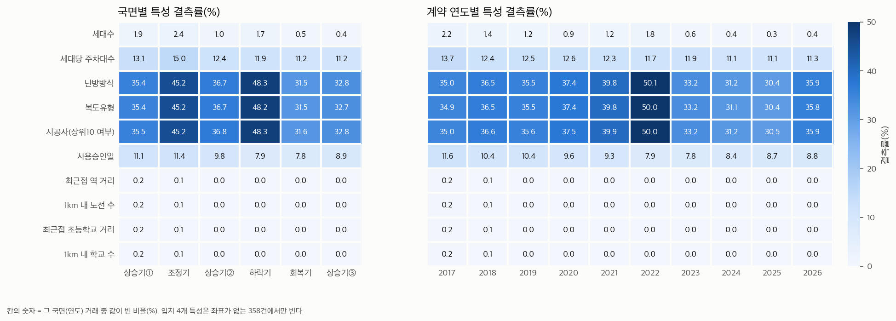

- 난방·복도·시공사 결측률은 하락기 48.3%, 조정기 45.2%로 다른 국면(31.5~36.7%)보다 높다. §3.3의 구성 변화(하락 쪽 국면에 작은 단지 거래 비중 증가)와 같은 현상이다. **결측이 국면과 무관하지 않다.**
- 세대수 결측은 상승기① 1.88% → 상승기③ 0.38%로 과거일수록 높다. 입지 특성은 상승기①(0.18%) 외에는 거의 비지 않는다.
- 세대당 주차대수 결측은 국면마다 11.2~15.0%로 비교적 고르다. 여기에 "0으로 적힌" 4,550건은 포함되지 않는다(§1.4).

### 4.3 자치구별

| 자치구 | 거래 건수 | 세대수 | 세대당 주차대수 | 난방방식 | 복도유형 | 사용승인일 |
|---|---:|---:|---:|---:|---:|---:|
| 중랑구 | 20,105 | 1.08 | 12.48 | 59.27 | 59.27 | 16.64 |
| 은평구 | 23,162 | 1.08 | 9.45 | 50.67 | 50.67 | 1.52 |
| 관악구 | 19,501 | 1.44 | 9.16 | 49.61 | 48.41 | 7.53 |
| 양천구 | 27,602 | 0.09 | 3.08 | 43.13 | 43.13 | 15.37 |
| 강서구 | 36,480 | 0.44 | 12.99 | 40.35 | 40.35 | 12.99 |
| 금천구 | 10,820 | 0.53 | 6.24 | 40.19 | 40.19 | 11.87 |
| 구로구 | 31,605 | 0.81 | 14.19 | 40.18 | 40.20 | 15.23 |
| 마포구 | 24,182 | 0.91 | 11.64 | 40.10 | 40.10 | 8.11 |
| 종로구 | 5,352 | 0.86 | 4.99 | 39.29 | 39.29 | 3.81 |
| 강동구 | 33,586 | 3.54 | 18.13 | 38.43 | 38.43 | 14.19 |
| 중구 | 8,571 | 1.02 | 8.21 | 37.76 | 37.76 | 7.19 |
| 강남구 | 33,651 | 1.15 | 21.22 | 37.03 | 37.03 | 17.82 |
| 도봉구 | 24,509 | 0.52 | 16.94 | 36.34 | 36.34 | 13.15 |
| 용산구 | 12,081 | 0.26 | 15.96 | 35.36 | 35.36 | 5.48 |
| 서초구 | 26,508 | 5.94 | 14.19 | 33.76 | 33.76 | 10.28 |
| 서대문구 | 21,453 | 1.15 | 10.29 | 31.94 | 31.94 | 4.44 |
| 노원구 | 57,819 | 0.26 | 12.36 | 30.85 | 30.85 | 1.91 |
| 송파구 | 41,140 | 0.64 | 19.92 | 30.64 | 30.64 | 10.87 |
| 광진구 | 12,598 | 0.90 | 6.33 | 30.51 | 30.51 | 9.89 |
| 영등포구 | 28,016 | 1.29 | 9.03 | 29.54 | 29.54 | 11.05 |
| 성북구 | 32,724 | 0.45 | 10.56 | 27.34 | 27.34 | 8.58 |
| 동대문구 | 24,812 | 0.48 | 5.47 | 26.62 | 26.62 | 5.98 |
| 성동구 | 24,932 | 0.32 | 4.51 | 22.93 | 22.93 | 6.23 |
| 동작구 | 23,738 | 1.59 | 9.40 | 20.90 | 20.90 | 7.99 |
| 강북구 | 12,645 | 0.22 | 19.15 | 20.09 | 20.09 | 6.90 |

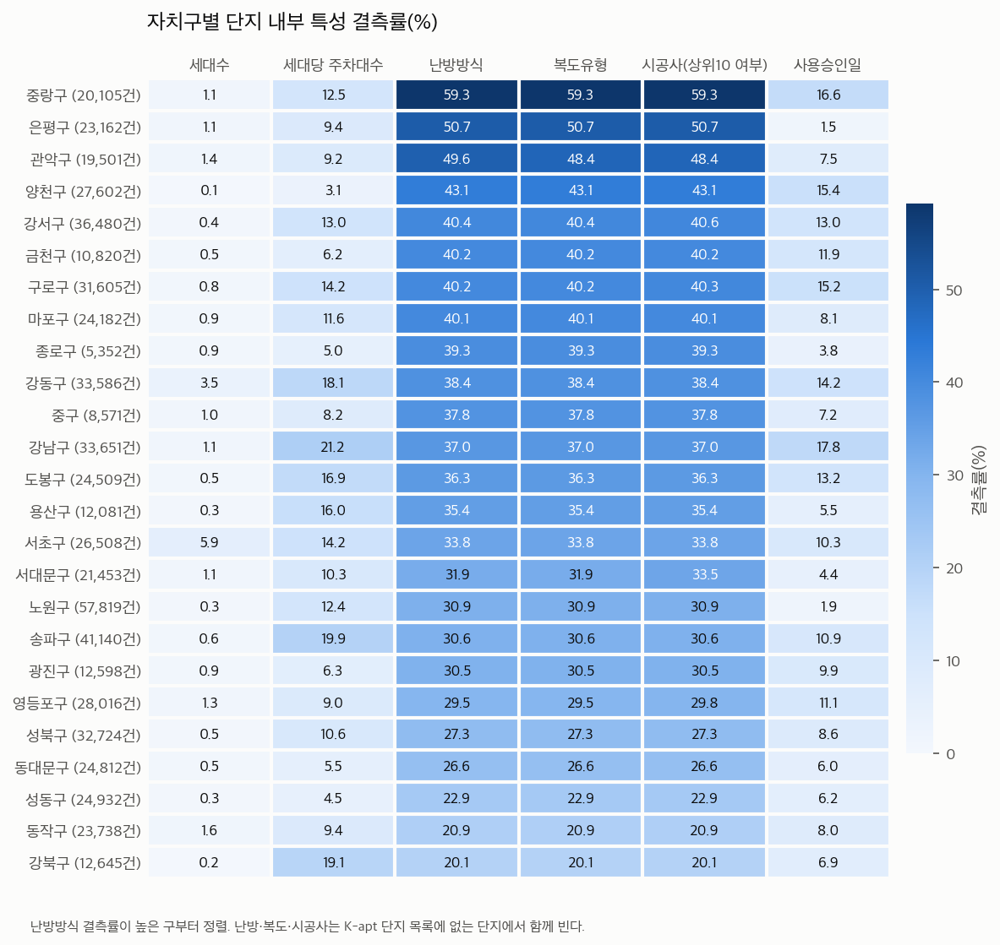

- 난방방식 결측률은 중랑구 59.3%에서 강북구 20.1%까지 벌어진다. 자치구가 특성이므로 결측 표시 변수와 자치구 효과가 일부 겹친다.
- 세대당 주차대수 결측은 강남구(21.2%) · 송파구(19.9%)에서 높다.

### 4.4 과거 자료의 한계

| 건축 시기 | 거래 건수 | 세대수 | 세대당 주차대수 | 난방방식 | 사용승인일 |
|---|---:|---:|---:|---:|---:|
| 1979년 이전 | 13,999 | 13.16 | 69.94 | 58.90 | 37.02 |
| 1980년대 | 83,331 | 3.09 | 31.19 | 40.41 | 20.30 |
| 1990년대 | 164,412 | 0.43 | 10.14 | 31.03 | 16.77 |
| 2000년대 | 218,404 | 0.41 | 4.64 | 34.04 | 3.68 |
| 2010년대 | 111,925 | 0.39 | 10.87 | 34.96 | 1.45 |
| 2020년 이후 | 25,521 | 1.37 | 3.14 | 44.23 | 2.19 |

- **오래된 단지일수록 정보가 빈다.** 1979년 이전 단지의 거래는 세대당 주차 69.9%, 사용승인일 37.0%, 세대수 13.2%가 결측이다. 재건축 연한(30년)에 가까운 단지, 즉 연구가 관심을 두는 집단에서 건물 특성이 가장 덜 채워져 있다.
- **현재값을 과거에 적용한 가정.** `단지정보_현재값가정 = 예`인 거래가 국면별 51.8~68.5%다. 세대수·주차·난방·복도·시공사는 조회 시점의 값이며, 리모델링·난방 전환·증축이 있었다면 과거 거래에 붙은 값은 당시와 다르다. 이 자료로는 얼마나 다른지 알 수 없다.
- **입지 값은 시점을 반영한다.** 같은 단지 안에서 계약 시점에 따라 값이 달라진 단지: 최근접 역 거리 478개(5.3%), 1km 내 노선 수 856개(9.5%), 최근접 초등학교 거리 152개(1.7%), 1km 내 학교 수 679개(7.6%). 역 개통·학교 신설이 계약일 기준으로 들어가 있다는 뜻이다. 다만 좌표는 단지 대표점 또는 지오코딩 지점이고 거리는 직선거리다.
- **좌표 정밀도가 국면마다 다르다.** 지오코딩(주소 지점) 좌표의 비중이 하락기 37.5%, 조정기 32.4%, 회복기 17.1%다. K-apt 미등록 단지 비중과 같이 움직인다.
- **2017~2019년에는 거래 해제 표시가 없다**(문서 기재). 해제된 거래가 섞여 있어도 이 자료로는 걸러낼 수 없다. 상승기①과 조정기 전체, 상승기② 초반이 해당한다.
- **동(棟)** 은 68.70%가 비어 있어 쓰지 않는다(2022년 이전 미공개).

### 4.5 역·학교 거리

| 직선거리 | 역: 거래 건수 | 역: 비율(%) | 초등학교: 거래 건수 | 초등학교: 비율(%) |
|---|---:|---:|---:|---:|
| 250m 이하 | 90,824 | 14.71 | 224,184 | 36.32 |
| 250~500m | 240,157 | 38.91 | 304,100 | 49.27 |
| 500~750m | 161,789 | 26.21 | 80,215 | 13 |
| 750m~1km | 67,005 | 10.86 | 8,050 | 1.30 |
| 1~1.5km | 41,458 | 6.72 | 561 | 0.09 |
| 1.5km 초과 | 16,001 | 2.59 | 124 | 0.02 |

| 국면 | 역 거리 중앙값(m) | 역 500m 이내(%) | 1km 내 노선 수 평균 | 초등학교 거리 중앙값(m) | 1km 내 학교 수 중앙값 |
|---|---:|---:|---:|---:|---:|
| 상승기① | 491 | 51.51 | 1.64 | 300 | 10 |
| 조정기 | 480 | 53.24 | 1.63 | 313 | 9 |
| 상승기② | 483 | 52.61 | 1.68 | 304 | 10 |
| 하락기 | 457 | 57.87 | 1.78 | 328 | 9 |
| 회복기 | 460 | 56.85 | 1.81 | 298 | 10 |
| 상승기③ | 465 | 55.55 | 1.78 | 304 | 10 |

- 거래의 53.6%가 역 500m 이내, 85.6%가 초등학교 500m 이내다. 초등학교 거리는 값의 폭이 좁아 단지 사이 차이가 작다.
- 역 500m 이내 거래 비중은 상승기① 51.5%에서 하락기 57.9%로 높아진다. 새 역 개통(시점 반영)과 거래 구성 변화가 함께 들어 있어, 이 표만으로 둘을 나눌 수 없다.

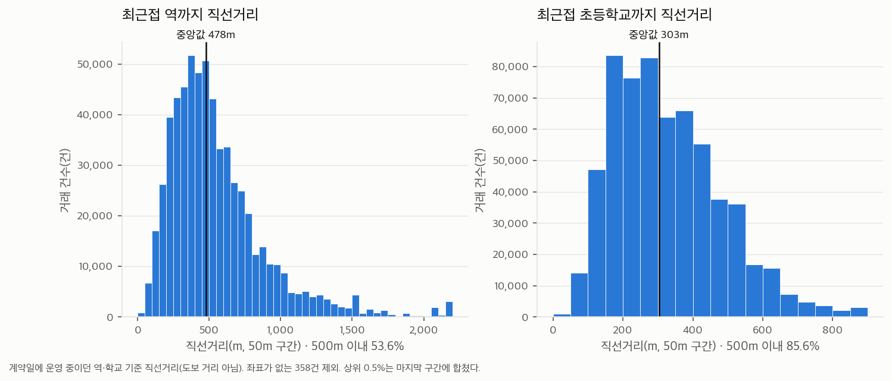

## 5. 해석할 때 지킬 것 (누출·편향)

1. **EDA 통계는 모델 입력이 아니다.** 이 보고서의 가격 통계(거래금액·㎡당가·상대 가격)는 y의 재료이므로 특성으로 쓰지 않는다. 특성 목록은 `config/features.yaml`에 고정되어 있고 이 EDA로 바꾸지 않았다.
2. **국면은 사후 구분이다.** 경계는 2026년까지의 지수를 본 뒤 정해졌다. 국면별 통계는 과거를 설명할 뿐, 그 시점에 알 수 있던 정보가 아니다.
3. **이 EDA는 전체 자료를 봤다(test 법정동 포함).** 다룬 것은 거래 단위의 수준·구성·결측이고 y와 특성의 관계는 보지 않았다. 그래도 이 결과를 근거로 특성·하이퍼파라미터를 고르면 test 정보가 새는 것이므로, 선택은 학습 80% 안에서만 한다(`config/split.yaml`).
4. **계약일 기준 값과 a월 기준 값을 구분한다.** `건물연식`, `연식_개월`, 역·학교 거리, 토지거래허가구역은 계약일 기준이다. 모델에는 국면 시작 월 a 기준으로 다시 계산한 값이 들어간다.
5. **단지 내부값은 현재값이다.** 과거 거래에 미래 시점의 단지 정보가 붙어 있다. 변하지 않는 값이라는 가정 아래에서만 쓸 수 있다.
6. **원시 가격을 국면끼리 비교하지 않는다.** 거래 구성이 국면마다 다르다(§3.3).
7. **연관 관계다.** "오래된 단지가 비싸다"가 아니라 "오래된 단지 중 거래된 집의 ㎡당가가 높았다"로 쓴다.

## 6. 모델링 담당에게 넘기는 확인 사항

결정은 담당자·팀의 몫이다. EDA에서 확인된 사실만 적는다.

- 세대당 주차대수 **0** 4,550건(13개 단지)은 결측으로 표시되어 있지 않다. 결측으로 볼지 정해야 한다(`tables/01_주차0_단지.csv`).
- 세대당 주차대수 **> 3**은 3,869건이다(문서 3,350건).
- `사용승인일`에 날짜가 아닌 값 17건이 있다. a월 기준 연식을 다시 계산할 때 `pd.to_datetime`이 오류를 낸다.
- `연식_기준 = '준공 전 거래'`는 253건이다(`docs/handoff.md`의 125건과 다름).
- 난방·복도·시공사의 결측 표시 변수는 "K-apt 미등록(소규모) 단지" 표시와 거의 같다. 결측률이 자치구에 따라 20~59%, 국면에 따라 32~48%로 다르다.
- 하락기·조정기는 거래된 단지가 전체의 46%·40%이고 그중 43%·45%가 거래 1건이다. 국면별로 남은 셀의 구성(세대수·면적·자치구)을 성능표와 함께 보고할 필요가 있다.
- 같은 조건 거래 묶음(두 번째 이후 행 기준 전체의 0.73%)은 셀 중앙값에 영향을 줄 수 있다. 소형 평형 셀에 몰려 있다.

## 7. 산출물

| 위치 | 내용 |
|---|---|
| `src/eda/` | 계산 코드(`load`, `quality`, `price`, `regime`, `coverage`, `plots`, `report`, `run_eda`) |
| `reports/eda/tables/` | 표 59개(CSV, UTF-8-SIG). 앞 번호 01 품질 · 02 가격 · 03 국면 · 04 특성 |
| `reports/eda/figures/` | 그림 11개(PNG) |
| `reports/eda/summary.json` | 핵심 숫자(테스트가 실제 파일과 다시 대조) |
| `notebooks/02_EDA.ipynb` | 위 표·그림을 읽어 보여 주는 노트북(계산 없음) |
| `tests/test_eda.py` | 함수 단위 테스트 + 저장된 숫자의 재계산 대조 |

다시 만들기: `python src/eda/run_eda.py` (약 1분).
