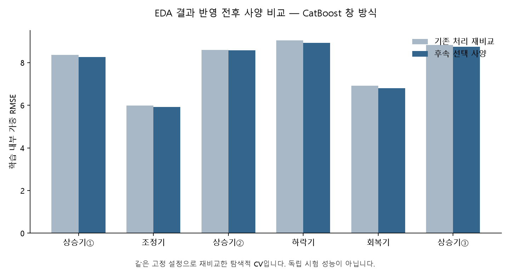

# EDA 결과 반영 후 — 결측치 처리와 특성 공학 비교

2026-11-16 · v2 탐색 실험. 기존 v1 결과와 시험 동네는 변경하지 않았다.

**모델 판단:** 두 모델을 비교한 12개 표 중 CatBoost의 선택 사양이 12개에서 더 낮은 CV 오차를 보였다. 기존 주모델 CatBoost를 유지하고 Ridge는 효과 방향을 대조하는 보조 모델로 사용하는 판단을 뒷받침한다. 수치형·범주형 특성과 결측을 함께 다룰 수 있다는 장점도 있다. 다만 이번 결과는 학습 내부 탐색이며 새 시험 성능을 입증하지 않는다.

## 무엇을 비교했나

학습 동네만 사용해 12개 국면×방식에서 아래 7개 사양과 Ridge·CatBoost를 비교했다. 총 168개 비교, 각 5-fold로 840회 적합했다.
v1에서 선택한 모델 설정·CatBoost 최종 반복 수를 고정해 모든 사양에 동일하게 적용했다. 랜덤포레스트의 v1 결과는 보존했으며 이번 사양 탐색에서는 재학습하지 않았다.
기존 처리도 동일한 고정 반복 수로 다시 비교했으므로 v1의 fold별 조기 종료 CV 점수와 직접 같지 않다.

| 사양 | 처리 |
|---|---|
| baseline | 기존 처리 재비교 |
| quality | 주차 0 결측·승인월 보완 |
| parking_cap | 품질 처리 + 주차 상한 3 |
| without_sparse | 품질 처리 + 난방·복도·시공사 제외 |
| log_numeric | 품질 처리 + 규모·거리 로그 변환 |
| extended | 품질 처리 + 통제변수 4개 |
| equal_weight | 품질 처리 + 학습 가중치 동일 |

품질 처리에서 주차 0은 오류 확정이 아니라 결측 가정의 민감도다. 승인일의 일자가 00이면 유효한 연·월을 살린다. 대상은 기존 v1 학습 셀로 고정했다.
로그 변환은 세대수·역 거리·초등학교 거리에 log1p를 적용한다. 확장 변수는 토지거래허가구역·과거 가격대·직전 국면 y·회전율이다.
동일 가중치 사양은 학습 가중치만 바꾸고 평가에는 기존 가중치를 사용한다. 민감도 전용이며 선택 대상에서는 제외했다.

## 국면별 학습 내부 결과



아래는 주 분석인 창 방식이다. 오차는 가중 RMSE이며 작을수록 좋다. 각 모델에서 사양을 따로 선택했다.

| 국면 | 모델 | 기존 처리 RMSE | 선택 사양 | 선택 RMSE |
|---|---|---:|---|---:|
| 조정기 | catboost | 5.985 | 품질 처리 + 통제변수 4개 | 5.912 |
| 조정기 | ridge | 6.054 | 품질 처리 + 통제변수 4개 | 5.995 |
| 하락기 | catboost | 9.048 | 품질 처리 + 통제변수 4개 | 8.923 |
| 하락기 | ridge | 10.543 | 품질 처리 + 통제변수 4개 | 9.946 |
| 회복기 | catboost | 6.921 | 품질 처리 + 통제변수 4개 | 6.792 |
| 회복기 | ridge | 7.693 | 품질 처리 + 통제변수 4개 | 7.170 |
| 상승기① | catboost | 8.358 | 품질 처리 + 주차 상한 3 | 8.268 |
| 상승기① | ridge | 9.456 | 품질 처리 + 규모·거리 로그 변환 | 9.268 |
| 상승기② | catboost | 8.589 | 품질 처리 + 통제변수 4개 | 8.571 |
| 상승기② | ridge | 11.646 | 품질 처리 + 규모·거리 로그 변환 | 11.288 |
| 상승기③ | catboost | 8.830 | 품질 처리 + 통제변수 4개 | 8.742 |
| 상승기③ | ridge | 10.996 | 품질 처리 + 규모·거리 로그 변환 | 10.579 |

선택 횟수(창·기울기 12개 표): catboost 기존 처리 재비교 1개; catboost 품질 처리 + 통제변수 4개 10개; catboost 품질 처리 + 주차 상한 3 1개; ridge 품질 처리 + 통제변수 4개 6개; ridge 품질 처리 + 규모·거리 로그 변환 6개.

후속 비교의 두 모델 중 표별 최저 CV 오차: catboost 12개. 랜덤포레스트를 포함한 새 최종 모델 선정을 뜻하지는 않는다.

**이 숫자는 독립 시험 성능이 아니다.** EDA가 전체 자료를 보았고, v1 설정과 동일한 학습 fold를 재사용했다. 사양 선택까지 한 CV 최저값은 낙관적일 수 있다. 새 효과·성능의 확증에는 새 외부 검증이 필요하다.

## 데이터 품질과 표본 편향

- 원자료 주차 0값 4,550건, 3 초과 3,869건, 승인일 형식 오류 17건을 재확인했다. 월 보완은 학습 셀×표 1행에 영향을 줬다.
- 결측은 모델별로 처리한다. CatBoost 숫자 NaN·범주 결측 토큰, Ridge는 학습 fold 중앙값·원핫·표준화. 모든 사양에서 사용한 특성의 결측 표시를 유지한다.
- 난방·복도·시공사 결측은 K-apt 연결 및 소규모 단지와 겹친다. 이 변수군 제외 실험과 결측/관측 집단별 OOF 오차를 별도로 저장했다.
- 국면별 적격 학습 거래와 남은 학습 셀의 면적·세대수·소형 비중을 비교했다. 서로 집계 단위가 다르며, 표본 구성 진단용이지 선택 편향 보정은 아니다.
- 동일 조건 거래를 가상으로 중복 제거했을 때 목표값 변화의 가중 RMS는 0.071~0.344였다. 일부 셀은 최대 18.12까지 변해 개별 셀 민감도가 남는다. 실제 거래인지 구분할 수 없어 원본은 삭제하지 않았다.

## 파일과 재현

- [전체 비교](cv_comparison.csv), [모델별 선택](cv_choices.csv), [집단별 오차](group_errors.csv)
- [품질 점검](quality_audit.csv), [표본 구성](cohort_composition.csv), [중복 가정 민감도](duplicate_target_sensitivity.csv)
- [모델 해석 — 국면별 주요 특성과 SHAP](interpretation.md)
- 설정: `config/followup.yaml`. 실행 순서: 아래 명령을 저장소 루트에서 실행한다.

```bash
python src/model/followup.py audit
python src/model/followup.py compare
python tools/audit_duplicate_sensitivity.py
python src/model/interpret_followup.py
python tools/verify_followup.py
python tools/plot_followup.py
python tools/report_followup.py
```

학습 모델·행별 OOF·재시작 캐시는 Git 제외 `results/followup_v2/`에 저장된다. 입력·코드 해시가 달라지면 기존 캐시 재사용을 거부한다.

## 남은 검토

주차 출처 확인, 창 폭 변경, 2020년 이후 표본, 좌표 출처별 분석, 다음 국면 예측과 새로운 외부 검증은 아직 하지 않았다. 이번 작업은 EDA 지적 사항에 대한 학습 내부 비교와 탐색적 해석이다.
